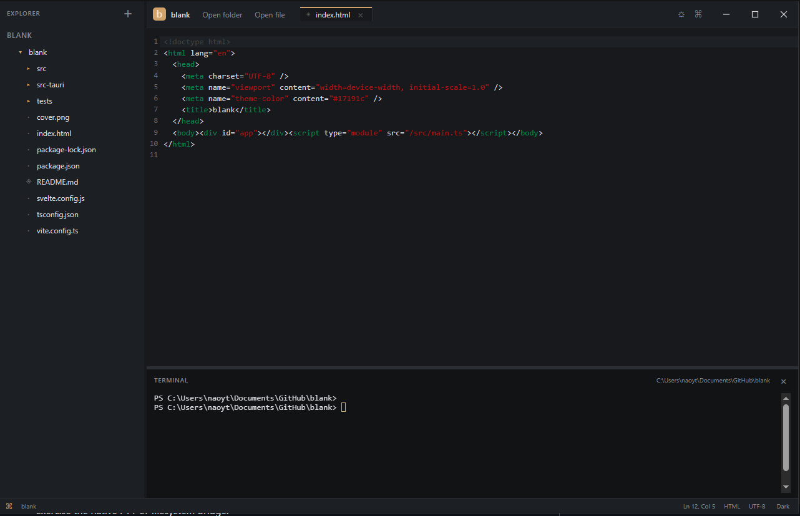

# Blank



A small offline desktop editor named blank, built with Tauri 2, Svelte, TypeScript, CodeMirror 6, markdown-it, KaTeX, and xterm.js. It focuses on local text/code editing, a safe Markdown preview, and a real interactive shell.

## Features

- Project explorer that expands directories on demand
- Multi-tab CodeMirror editor with undo, syntax colors, line numbers, bracket matching, and dirty-state indicators
- Markdown preview with tables, task lists, fenced code highlighting, and `$...$`, `$$...$$`, `\(...\)`, `\[...\]` math
- Lazy xterm.js panel connected to a portable-pty shell
- Dark and light themes; resizable sidebar, preview split, and terminal
- Keyboard shortcuts listed below

## Architecture

The Svelte UI owns tab and view state. Rust commands authorize a selected workspace and restrict file reads/writes and terminal working directories to it. Markdown HTML is generated locally with raw HTML disabled, unsafe URL schemes rejected, KaTeX in trust-off mode, and DOMPurify as a final sanitization step. The terminal and file-type language extensions load only when needed.

## Prerequisites

- Node.js 20.19+ or 22.12+ and npm
- Rust stable toolchain
- Windows: Microsoft C++ Build Tools and WebView2 Runtime
- macOS: Xcode Command Line Tools
- Linux: WebKitGTK and GTK development packages supported by Tauri 2

## Install and run

```sh
npm install
npm run tauri dev
```

For the frontend alone, run `npm run dev`; native filesystem and terminal features require the Tauri host.

## Checks and packaging

```sh
npm run check
npm test
npm run build
npm run tauri build
```

The native build produces platform packages under `src-tauri/target/release/bundle/`.

Every push to the `release` branch also builds Windows (`.exe`/`.msi`), macOS (`.dmg`/`.app`), and Linux (`.deb`/`.AppImage`) packages with GitHub Actions. Download them from the run's **Artifacts** section on the repository's Actions page. These are unsigned CI builds; macOS may show a security prompt when opening them.

## Shortcuts

| Action | Windows/Linux | macOS |
|---|---|---|
| Save | Ctrl+S | Cmd+S |
| Save As | Ctrl+Shift+S | Cmd+Shift+S |
| Open file | Ctrl+O | Cmd+O |
| Open folder | Ctrl+Shift+O | Cmd+Shift+O |
| Quick open recent file | Ctrl+P | Cmd+P |
| New untitled file | Ctrl+N | Cmd+N |
| Close tab | Ctrl+W | Cmd+W |
| Toggle explorer | Ctrl+B | Cmd+B |
| Toggle terminal | Ctrl+` | Ctrl+` |
| Toggle Markdown preview | Ctrl+Shift+P | Cmd+Shift+P |

Close-tab and app-close actions ask before discarding unsaved changes. Quick open searches recently opened files because the MVP intentionally does not index the full project tree.

## Known limitations

- Files and terminal working directories are scoped to the selected project folder. Save As outside that folder is rejected.
- External edits are not watched or merged automatically. A version check refuses to save over changes made after the file was opened; reopen the file to continue.
- `.tex` files have source editing only; complete LaTeX builds are out of scope.
- Integration tests that require the native Tauri shell need a Windows desktop session. Browser-only mode cannot exercise the native PTY or filesystem bridge.
- The project is initially configured to build on the current Windows host; macOS/Linux packaging should be verified on those platforms.
